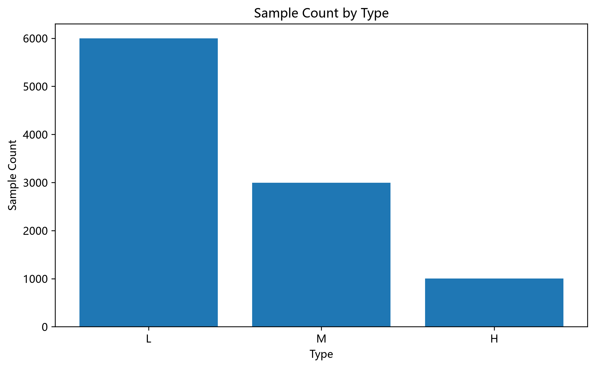
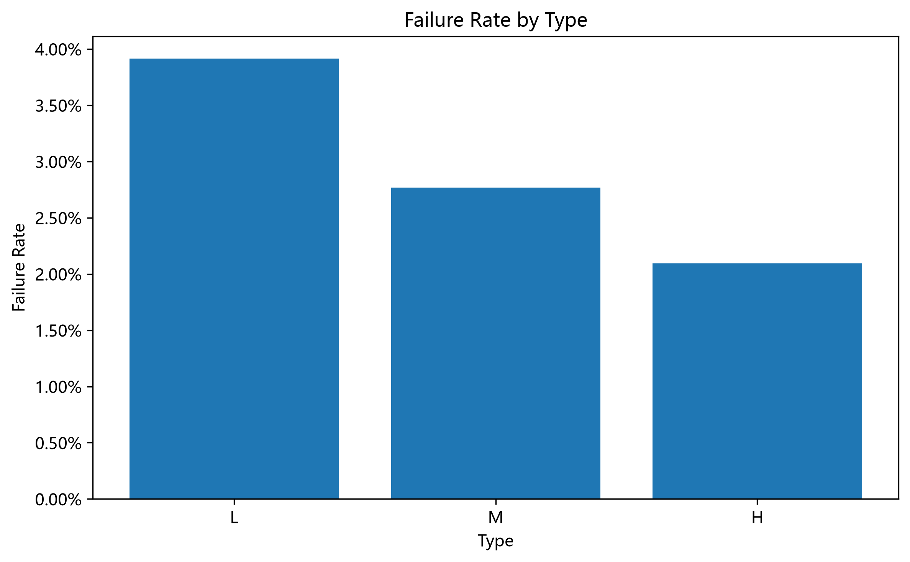
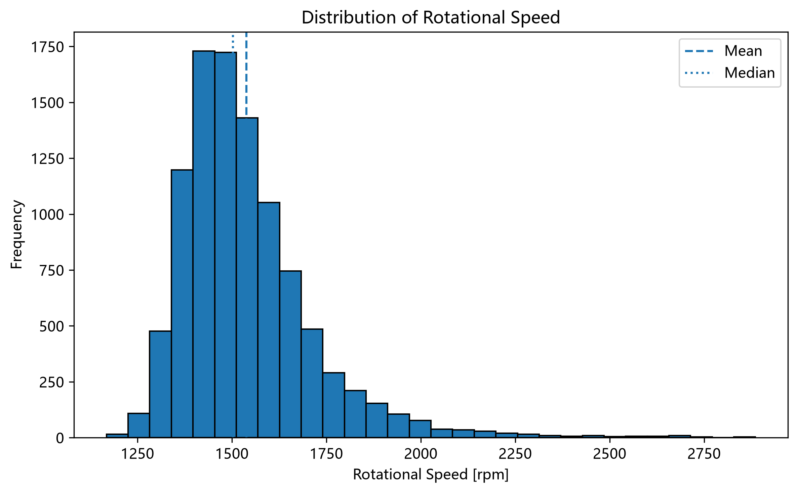
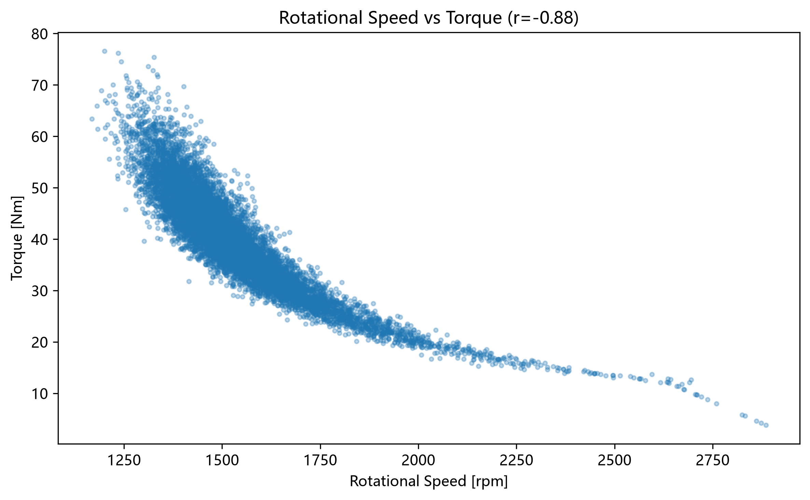
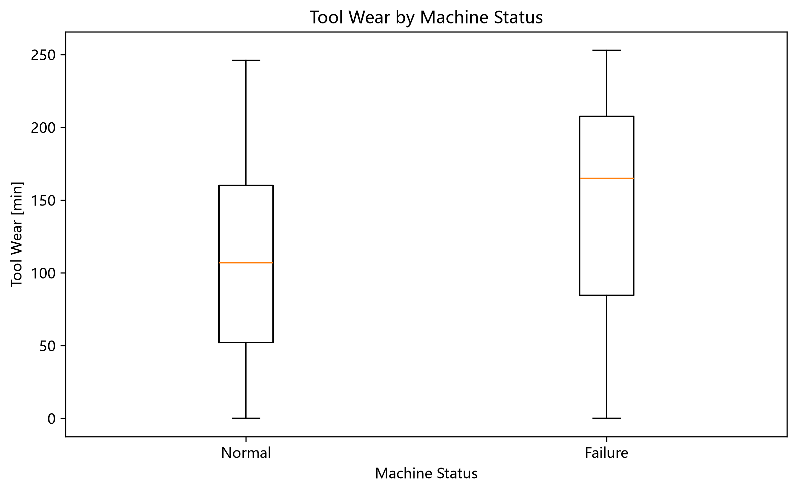
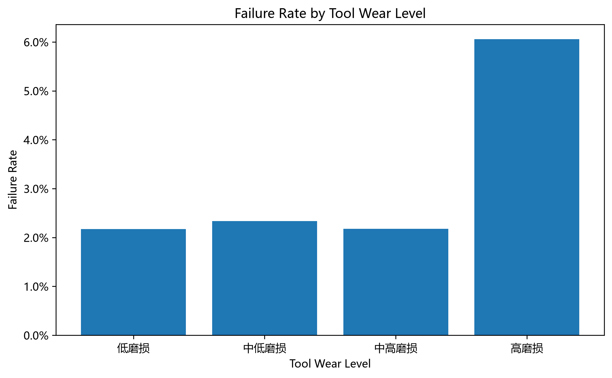

# 工业设备预测性维护数据探索性分析（Mini EDA）

## 项目简介

本项目使用 Pandas 和 Matplotlib 对工业设备的运行参数及故障标签进行探索性数据分析（Exploratory Data Analysis，EDA），重点考察样本分布、设备运行参数、工具磨损与故障记录之间的关联。项目旨在练习数据质量检查、分组聚合、可视化和基于证据撰写分析结论，**不包含故障预测模型训练**。

## 数据集

- 名称：[AI4I 2020 Predictive Maintenance Dataset（UCI）](https://archive.ics.uci.edu/dataset/601/ai4i+2020+predictive+maintenance+dataset)
- 规模：10,000 条记录、14 列；原始数据没有缺失值
- 性质：**合成数据**，用于模拟工业预测性维护场景，并非实际工厂采集的原始记录
- `Type`：产品质量类别（L / M / H）
- `Rotational speed [rpm]`：转速；`Torque [Nm]`：扭矩；`Tool wear [min]`：工具磨损时间
- `Machine failure`：故障标记，0 表示正常，1 表示故障

数据来源与署名：*AI4I 2020 Predictive Maintenance Dataset* (2020), UCI Machine Learning Repository, DOI: [10.24432/C5HS5C](https://doi.org/10.24432/C5HS5C)。数据集按 [CC BY 4.0](https://creativecommons.org/licenses/by/4.0/) 授权，使用与再分发时应保留来源署名。

## 项目结构

```text
mini-eda-project/
├── data/
│   └── ai4i2020.csv
├── figures/
│   ├── type_sample_count.png
│   ├── type_failure_rate.png
│   ├── rotational_speed_hist.png
│   ├── speed_torque_scatter.png
│   ├── tool_wear_boxplot.png
│   └── wear_failure_rate.png
├── eda.py
├── README.md
└── requirements.txt
```

## 运行方法

1. 安装 Python，并在终端进入 `mini-eda-project` 目录。
2. 安装依赖：

   ```bash
   python -m pip install -r requirements.txt
   ```

3. 从上方 UCI 数据集页面下载 `ai4i2020.csv`，放在 `data/` 目录中（如果本仓库已有此文件则不必重复下载）。
4. 运行：

   ```bash
   python eda.py
   ```

程序会在终端打印统计结果，并在 `figures/` 中保存 6 张 PNG 图表。脚本使用 `pathlib` 构造路径，可从其他工作目录运行。

## 可视化结果

### 1. 不同产品类型的样本数量



### 2. 不同产品类型的故障率



### 3. 转速分布



### 4. 转速与扭矩的相关关系



### 5. 正常与故障记录的工具磨损分布



### 6. 不同磨损等级的故障率



## 主要分析结论

1. **数据质量：** 原始数据共 10,000 条、14 列，公开数据说明中无缺失值；使用 `isna()` 和 `duplicated()` 进行质量检查。数据为合成数据，因此分析结论不能直接推广到真实设备。
2. **总体故障情况：** 正常记录 9,661 条、故障记录 339 条，故障率约 **3.39%**。类别分布明显不均衡，后续建模应同时关注召回率、精确率及 F1-score 等指标。
3. **产品类型分布：** L、M、H 类别分别有 6,000、2,997 和 1,003 条记录，样本分布并不均衡。
4. **不同类型故障率：** L、M、H 对应的故障率约为 **3.92%、2.77%、2.09%**。L 类相对较高，但不能仅据此证明产品类型是故障的原因。
5. **转速分布：** 转速均值约为 **1,538.78 rpm**，记录主要集中在约 **1,350–1,600 rpm**，存在少量超过 2,750 rpm 的记录；高转速不一定意味着异常。
6. **转速与扭矩：** Pearson 相关系数约为 **-0.88**，两者呈较强负线性相关，但相关性不等于因果关系。
7. **工具磨损与故障：** 箱线图对比了正常记录与故障记录的磨损分布。是否能用工具磨损单独预测故障，仍需要结合转速、扭矩等其他变量验证。
8. **磨损等级与故障率：** 在本项目的四个磨损区间中，中高磨损组的故障率低于中低磨损组，而高磨损组故障率明显上升；不同区间的故障率没有呈现简单的单调递增趋势。这是描述性观察，不构成非线性因果关系的证明。

## 局限性与后续工作

- 本项目仅进行描述性与探索性分析，不推断故障成因。
- 不同分组的样本量可能不同，故障率差异可能受到运行条件和统计波动影响。
- 若后续将其用于预测模型，应避免将故障模式标签 `TWF`、`HDF`、`PWF`、`OSF`、`RNF` 直接作为预测 `Machine failure` 的普通输入特征，防止目标信息泄漏。
- 后续可以建立简单分类基线，并使用分层训练/测试划分与合适的评价指标进行验证。
